<p align="center">
  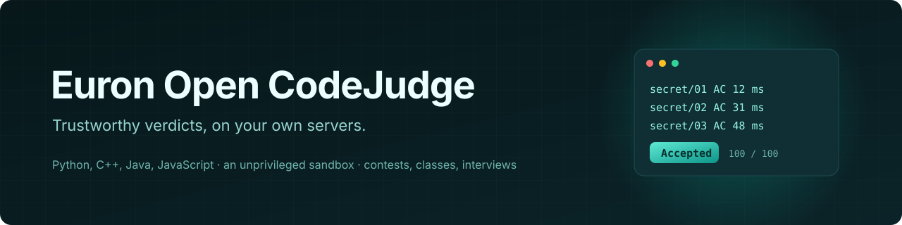
</p>

<p align="center">
  
  <a href="LICENSE"></a>
  
  
  
  
  
  
  
</p>

<p align="center">
  <a href="https://github.com/euron-sde-team/euron-open-codejudge/stargazers"></a>
  <a href="https://github.com/euron-sde-team/euron-open-codejudge/fork"></a>
  <a href="https://github.com/euron-sde-team/euron-open-codejudge/watchers"></a>
  <br>
  <a href="https://github.com/euron-sde-team/euron-open-codejudge/issues"></a>
  <a href="https://github.com/euron-sde-team/euron-open-codejudge/pulls"></a>
  <a href="https://github.com/euron-sde-team/euron-open-codejudge/commits/main"></a>
  
  <br>
  <a href="#built-by-the-team-behind-euron"></a>
</p>

<p align="center">
  <b><a href="#-quickstart">Quickstart</a></b> ·
  <b><a href="#️-architecture">Architecture</a></b> ·
  <b><a href="docs/architecture/sandbox.md">Sandbox</a></b> ·
  <b><a href="docs/guides/writing-problems.md">Write problems</a></b> ·
  <b><a href="docs/api/openapi.yaml">API reference</a></b> ·
  <b><a href="#️-deploy-to-aws">Deploy</a></b> ·
  <b><a href="docs/architecture/security.md">Security</a></b> ·
  <b><a href="#-documentation">Docs</a></b>
</p>

**Euron Open CodeJudge** is an open-source, MIT-licensed, self-hosted coding assessment
platform, part of the open-source initiative of **ENGAGESPHERE TECHNOLOGY PRIVATE
LIMITED**. Teachers, interviewers and contest organisers write programming problems with
hidden tests; students, contestants and candidates solve them in the browser in Python,
C++, Java or JavaScript; every submission is compiled and run in a sandbox and comes back
with a verdict you can trust, in seconds.

It is built for universities, bootcamps, interviewers, competitive programming clubs and
companies running technical tests. What makes it different:

- **A sandbox that needs no privileged container.** Each run gets fresh user, PID,
  network and mount namespaces from nsjail, a syscall filter and rlimits, inside a worker
  container with every Linux capability dropped. An escape from the inner sandbox lands as
  an unprivileged user with no network, not as root on the host (the failure mode that
  turned Judge0's 2024 sandbox bugs into host takeovers).
- **Judges that hold nothing.** Workers get a judge token and the queue's address: no
  database, no object storage, no session secret. The program never sees the expected
  answers; they are compared outside its sandbox.
- **Verdicts from measurements.** CPU time and peak memory are measured exactly, so a busy
  machine does not turn an accepted solution into a time limit, and every verdict is
  decided in a documented order. A problem cannot be published until its setter's own
  solutions get the verdicts they should.
- **One engine, every kind of test.** Practice, ICPC and IOI contests with a freeze, class
  assignments with deadlines and a gradebook, interview screens with one-time links for
  candidates who have no account, plagiarism checks, analytics.
- **Yours, and portable.** No per-submission fees, no code sent to a third party, problems
  in the open Kattis package format (import from and export to DOMjudge and Kattis), AI
  hints only if you turn them on and point them at your own model.

<p align="center">
  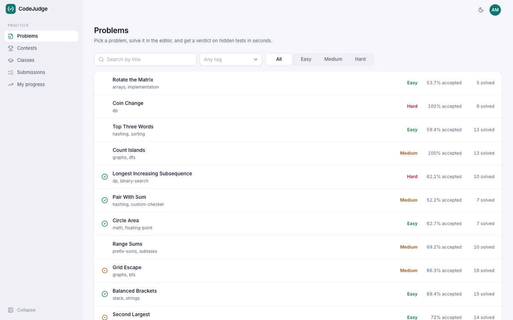
</p>

> [!NOTE]
> Everything in the tour ran for real: Docker Compose on a laptop, with S3, KMS and Secrets
> Manager emulated locally and provisioned by the same Terraform modules that build
> production. Every verdict was produced by the real judge workers, compiling and running
> the programs in their sandboxes; the demo seed submits real solutions in four languages,
> then copies those real verdicts into a month of history. The interview candidate opened
> the one-time link from their invitation email. The AI hint comes from a local mock
> model. `make up && make demo` reproduces it.

<h3 align="center">Built by the team behind Euron</h3>

<p align="center">Euron Open CodeJudge comes from the people who build these platforms. If you like how this repository is built, come and see what we build with it.</p>

<p align="center">
  <a href="https://euron.one"><picture><source media="(prefers-color-scheme: dark)" srcset="docs/assets/brand/euron-dark.svg"></picture></a>
  <a href="https://euronsystems.com"><picture><source media="(prefers-color-scheme: dark)" srcset="docs/assets/brand/euron-systems-dark.svg"></picture></a>
  <a href="https://alphaeuron.com"><picture><source media="(prefers-color-scheme: dark)" srcset="docs/assets/brand/alpha-euron-dark.svg"></picture></a>
</p>

<p align="center">
  <a href="https://www.instagram.com/euron_official"></a>
  <a href="https://www.linkedin.com/company/euronone/posts/"></a>
  <a href="https://x.com/euron712"></a>
  <a href="https://www.youtube.com/@Euron-official"></a>
  <a href="https://whatsapp.com/channel/0029VaeeJwq9RZAfPW9P2l07"></a>
</p>

---

## 📚 Table of contents

- [Why CodeJudge](#-why-codejudge)
- [At a glance](#-at-a-glance)
- [Screenshots](#️-screenshots)
- [Features](#-features)
- [Architecture](#️-architecture)
  - [The sandbox](#the-sandbox)
- [Tech stack](#-tech-stack)
- [Prerequisites](#-prerequisites)
- [Quickstart](#-quickstart)
- [Explore the repository](#-explore-the-repository)
- [API](#-api)
- [Configuration](#️-configuration)
- [Deploy to AWS](#️-deploy-to-aws)
- [Security model](#-security-model)
- [Testing](#-testing)
- [Documentation](#-documentation)
- [Roadmap](#️-roadmap)
- [FAQ](#-faq)
- [Contributing, security and license](#-contributing-security-and-license)

## 💡 Why CodeJudge

Every coding course, contest and technical interview needs the same thing: run code that
somebody else wrote, against tests they must not see, and decide fairly whether it works.
Hosted assessment platforms do it well and charge per candidate or per attempt, and every
submission goes to their servers. The open-source judges are mature but old, built for one
use (ICPC contests, or IOI, or a raw execution API), and most of them run their sandboxes
in privileged containers, which is how a sandbox bug becomes a server takeover.

CodeJudge is one engine for practice, contests, classes and interviews, on your own
infrastructure, with the sandbox designed first: unprivileged, measured, and proven by a
suite of hostile programs on every build. A teacher can clone it, run it on a laptop,
write a problem, submit a solution and get a trustworthy verdict in minutes.

## 📊 At a glance

| | |
| --- | --- |
| **Languages** | Python 3, C++17 (GCC), Java 21, JavaScript (Node.js); one registry file to add more |
| **Verdicts** | Accepted, Wrong Answer, Time Limit, Memory Limit, Runtime Error, Compilation Error, Output Limit, Internal Error (the judge's fault, never counted) |
| **Sandbox** | nsjail per run in an unprivileged container: namespaces, rlimits, a syscall filter, no network, no `/proc`, no test data |
| **Checkers** | Tokens, floats with tolerances, exact lines, custom (Kattis or testlib conventions) |
| **Scoring** | Pass or fail, or IOI-style groups with points |
| **Contests** | ICPC and IOI scoreboards, freeze and unfreeze, registration codes, clarifications |
| **Classes** | Join codes, assignments, late policies (accept, penalty, refuse), extensions, gradebook CSV |
| **Interviews** | Email invitations, one-time links, timers, paste and tab-away signals, reports |
| **Also** | Plagiarism (winnowing), analytics, optional AI hints, Kattis import and export, audit log |
| **Infrastructure** | 11 Terraform modules, 3 environments; the full AWS stack (NUMBER_PENDING(tf resources) resources) applied end to end against Floci |
| **Tests** | NUMBER_PENDING(test summary: unit API, unit web, integration, judge, e2e) |
| **License** | MIT |

## 🖼️ Screenshots

<table>
  <tr>
    <td width="50%">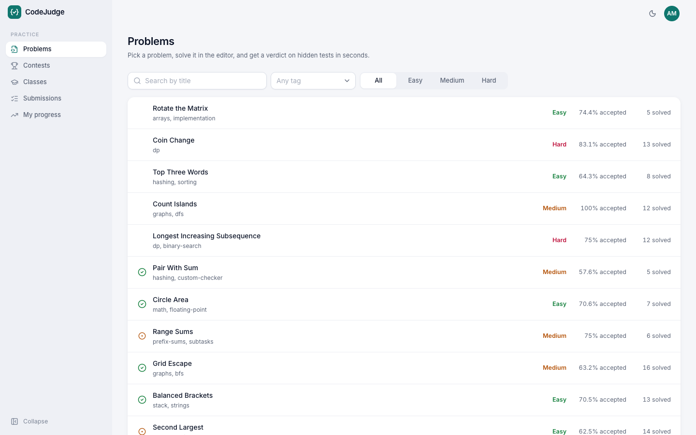<br><sub><b>Problems.</b> Search, tags, difficulty, your solved marks and acceptance. NUMBER_PENDING(screenshot)</sub></td>
    <td width="50%">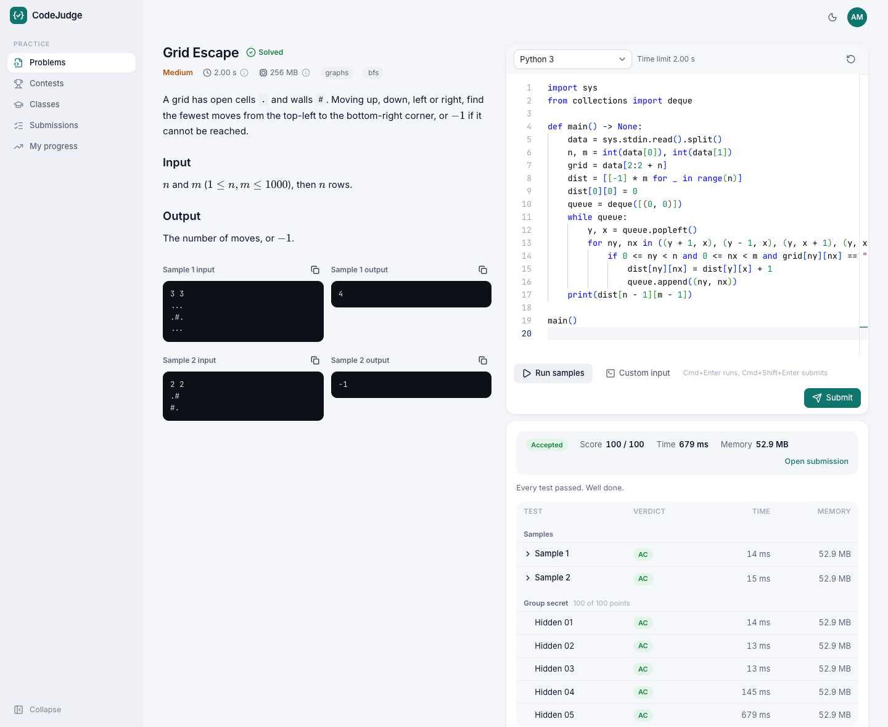<br><sub><b>Solve.</b> The statement beside the editor; run on the samples, submit, and watch the verdict arrive test by test. NUMBER_PENDING(screenshot)</sub></td>
  </tr>
  <tr>
    <td>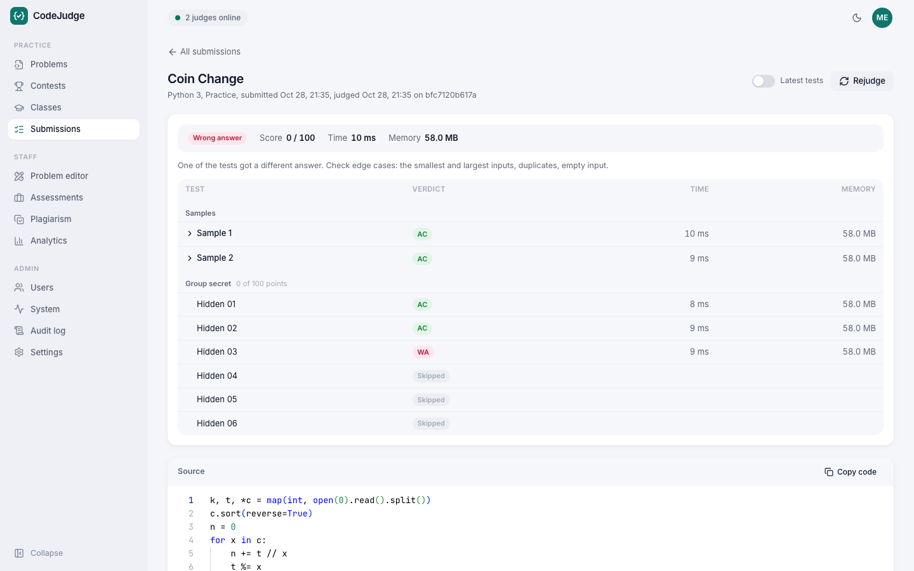<br><sub><b>Submission.</b> Verdict, score, time and memory per test; outputs for samples only. NUMBER_PENDING(screenshot)</sub></td>
    <td>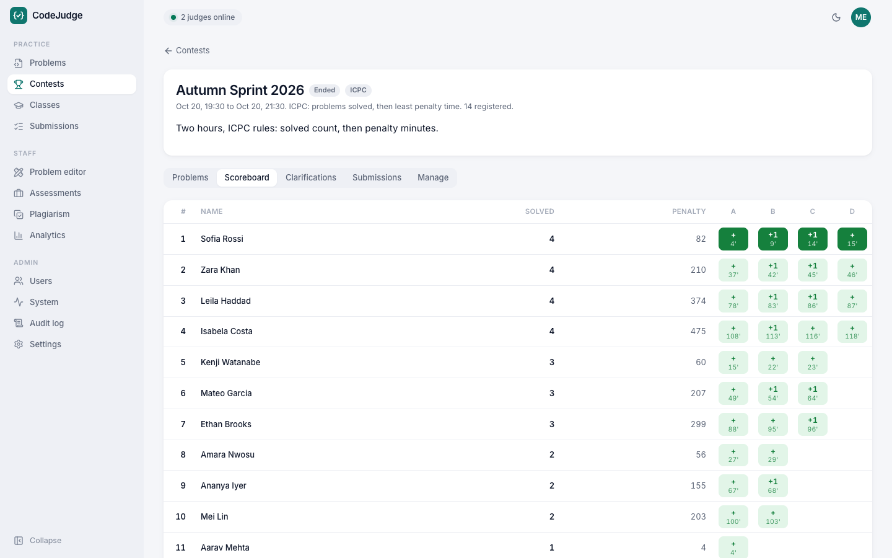<br><sub><b>Scoreboard.</b> ICPC or IOI, with first solves and the freeze. NUMBER_PENDING(screenshot)</sub></td>
  </tr>
  <tr>
    <td>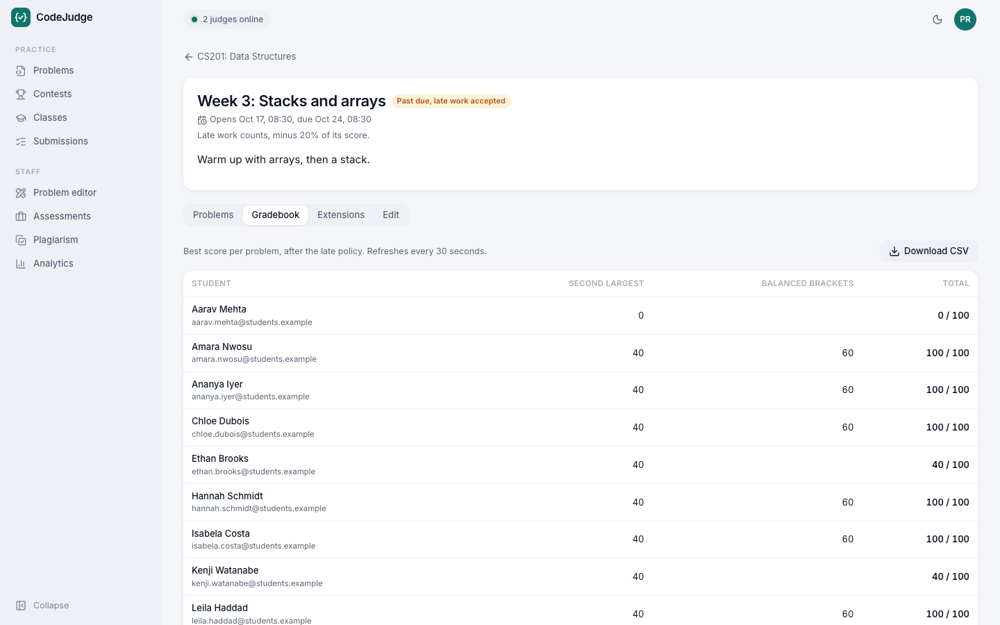<br><sub><b>Gradebook.</b> Best marks per student and problem, late penalties applied, CSV export. NUMBER_PENDING(screenshot)</sub></td>
    <td>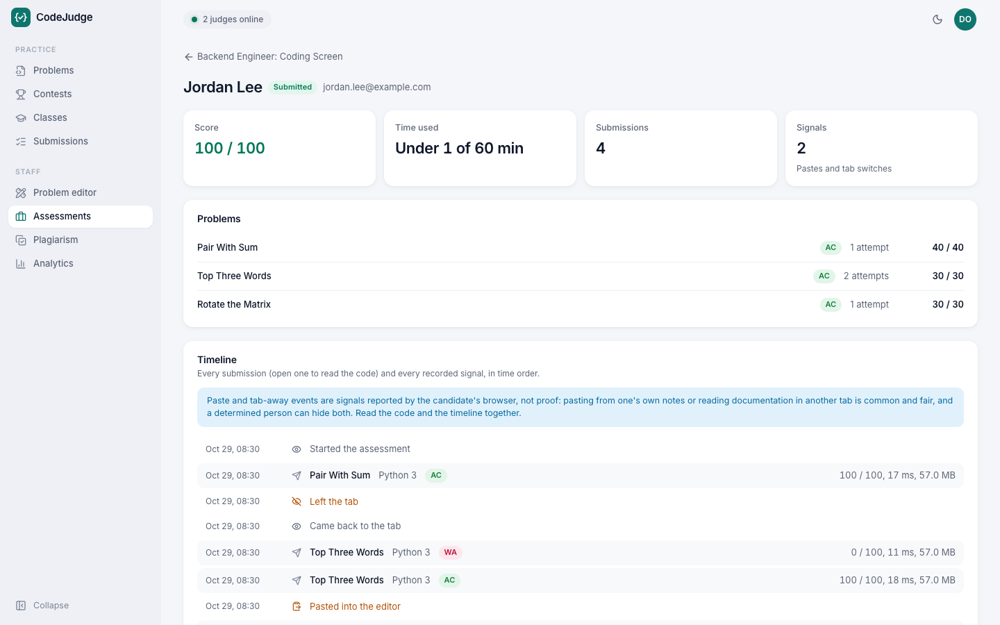<br><sub><b>Interview report.</b> Scores, every submission with code, and the timeline of signals. NUMBER_PENDING(screenshot)</sub></td>
  </tr>
  <tr>
    <td>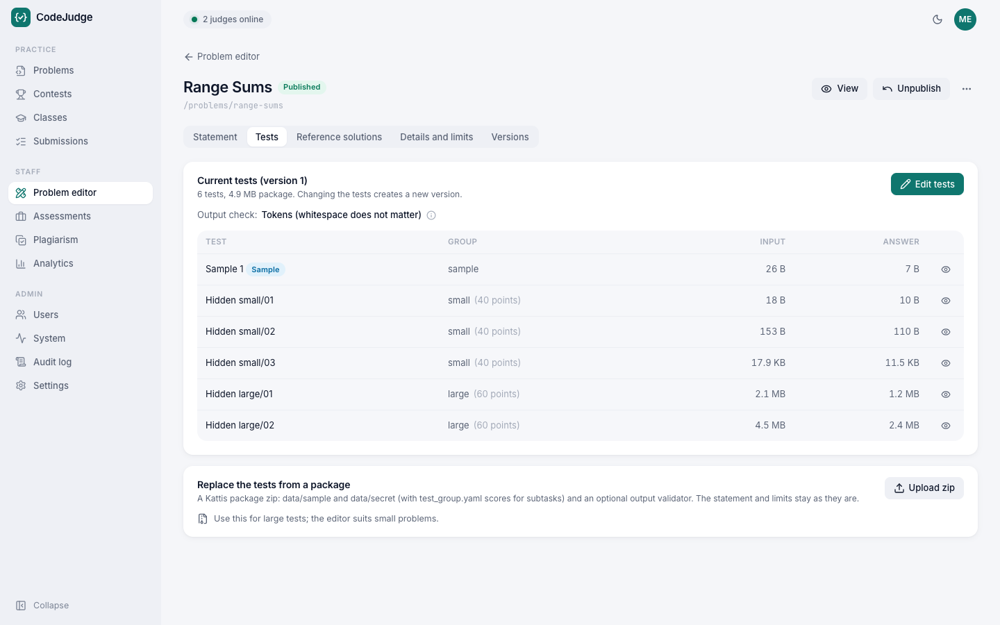<br><sub><b>Problem editor.</b> Statement, tests and groups, checker, reference solutions and what still blocks publishing. NUMBER_PENDING(screenshot)</sub></td>
    <td>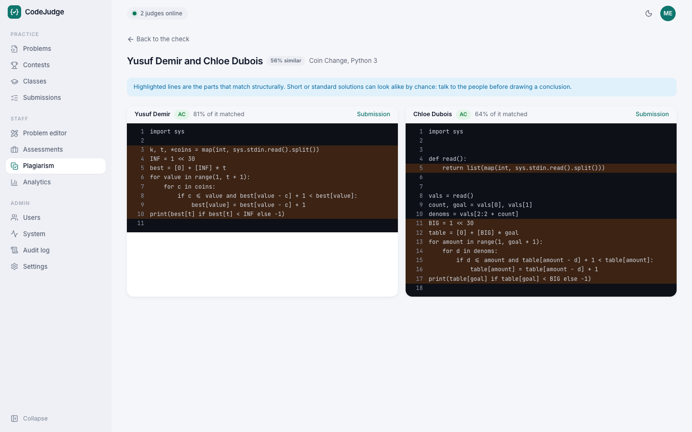<br><sub><b>Plagiarism.</b> Similar pairs side by side, matched lines highlighted. NUMBER_PENDING(screenshot)</sub></td>
  </tr>
  <tr>
    <td>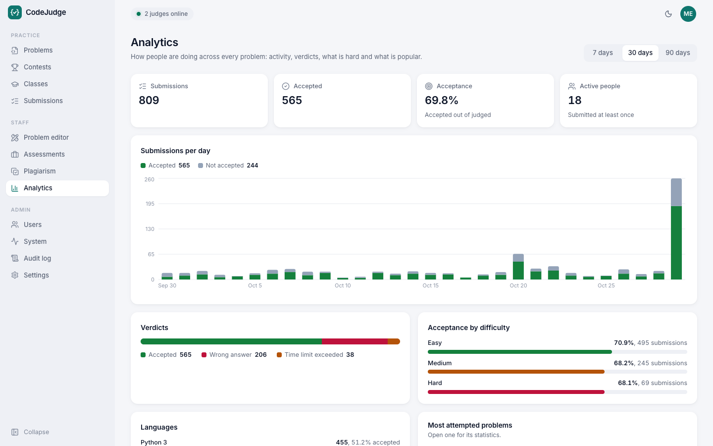<br><sub><b>Analytics.</b> Submissions, verdict mix and acceptance by difficulty. NUMBER_PENDING(screenshot)</sub></td>
    <td>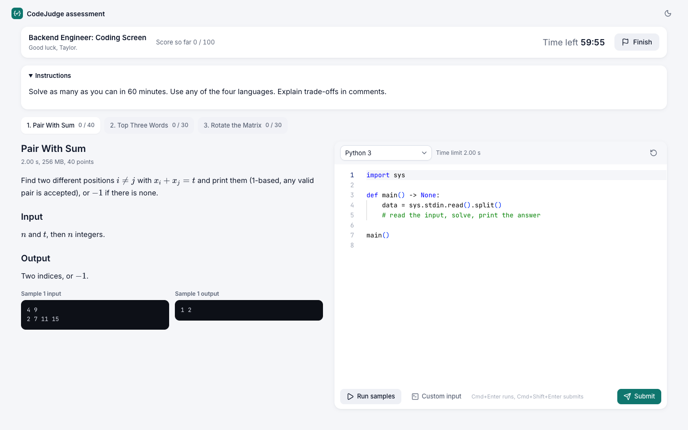<br><sub><b>Candidate.</b> A timed assessment from a one-time link, nothing else in sight. NUMBER_PENDING(screenshot)</sub></td>
  </tr>
  <tr>
    <td>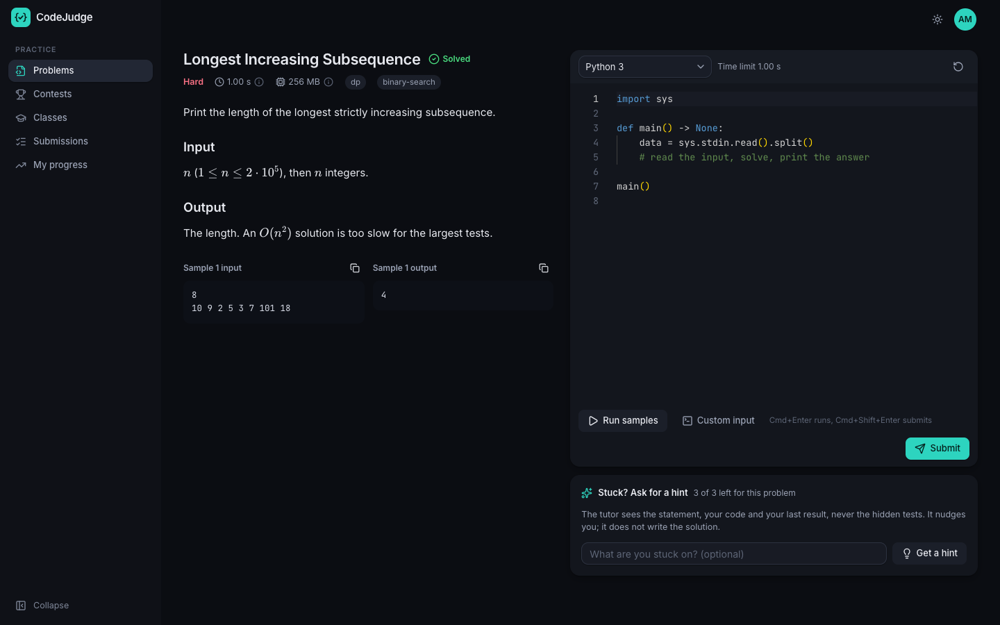<br><sub><b>Dark mode.</b> NUMBER_PENDING(screenshot)</sub></td>
    <td align="center">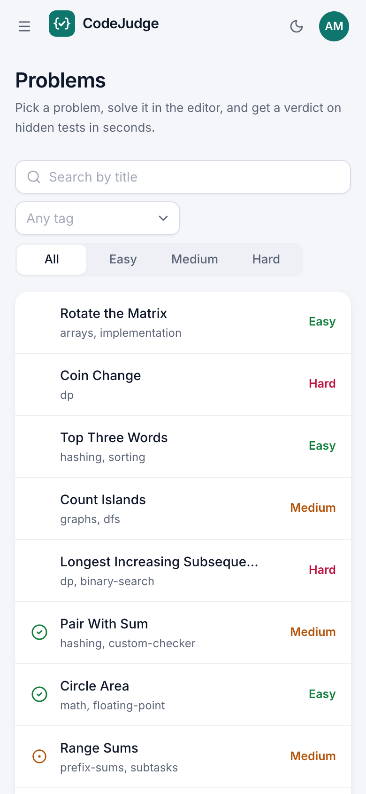<br><sub><b>Phone.</b> Responsive down to phone width. NUMBER_PENDING(screenshot)</sub></td>
  </tr>
</table>

## ✨ Features

<table>
<tr>
<td valign="top" width="50%">

#### ⚖️ Verdicts you can trust
- **CPU time and peak memory** measured with `wait4`, not wall clock guesses.
- **A fixed decision order**: internal error, output limit, time, memory, runtime error,
  then the checker ([why output comes first](docs/architecture/sandbox.md#deciding-the-verdict)).
- **Checkers**: tokens, floats with tolerances, exact, custom programs.
- **Groups with points** for partial scoring; samples always shown, hidden tests never.
- **A publish gate**: reference solutions must get their expected verdicts.
- **Rejudge** on the original or the current tests; versions keep results reproducible.

</td>
<td valign="top" width="50%">

#### 🔒 Hostile code, contained
- **nsjail per run**: user, PID, network, mount, IPC and UTS namespaces; uid 65534.
- **No privileges**: every capability dropped, Docker's seccomp plus namespace calls only.
- **A syscall filter** on the program: `ptrace`, `unshare`, `mount`, `bpf`, `io_uring`
  and more refused.
- **Limits**: CPU, memory, processes, output, files, stack, wall clock.
- **No test data, no network, no worker files** inside a sandbox.
- **Proven**: fork bombs, memory bombs, output floods, escapes and a compiler bomb in the
  test suite, then a correct verdict right after.

</td>
</tr>
<tr>
<td valign="top">

#### 🏆 Contests, classes, interviews
- **Contests**: ICPC penalties or IOI best scores, freeze, clarifications, private problems.
- **Classes**: join codes, assignments, deadlines, late policies, extensions, gradebook.
- **Interviews**: one-time links, a timer, signals shown as signals, a full report.
- **Plagiarism**: winnowing over normalised tokens; renaming and reordering do not hide a copy.
- **Analytics**: an exact daily rollup, per-problem and per-student pages.

</td>
<td valign="top">

#### 🧩 Yours to run
- **Self-hosted**: Docker Compose locally, Terraform for AWS; no per-submission fees.
- **Portable problems**: the Kattis package format, in and out.
- **Optional AI hints**: any OpenAI-compatible model, off by default, never in contests or
  assessments, never shown hidden tests.
- **A real editor**: Monaco bundled locally, drafts, run on samples or your own input,
  live verdicts.
- **Roles and audit**: student, staff, admin; every change recorded.

</td>
</tr>
</table>

## 🏗️ Architecture

<p align="center">
  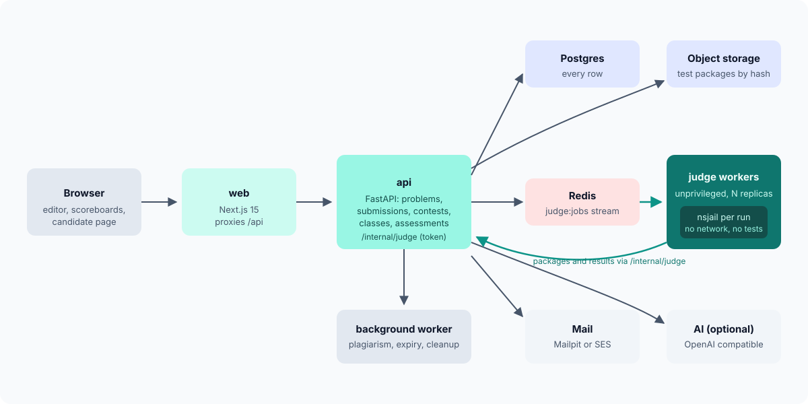
</p>

The **API** owns every row and decides who may submit where. Submissions go on a **Redis
Stream**; **judge workers** take them through a consumer group with leases, fetch the test
package by its SHA-256 from the API, judge, and post the result back, which the API applies
exactly once. A **background worker** runs plagiarism checks and periodic tasks. The **web
app** is the only origin the browser talks to.

<p align="center">
  
</p>

### The sandbox

<p align="center">
  
</p>

Two layers. The worker container has no privileges, a read-only root, and a network that
reaches only the API and Redis. Inside it, every compilation and every test runs in a fresh
nsjail sandbox that sees read-only system directories, its own box and a private `/tmp`,
gets only that test's input, and is measured from outside. The design, its trade-offs and
what it does not protect against are in [sandbox.md](docs/architecture/sandbox.md).

## 🧰 Tech stack

| Layer | Technology |
| --- | --- |
| Judge | nsjail 3.6 (built from source), GCC, OpenJDK 21, Node.js, Python 3.13 on Debian trixie |
| API, workers | FastAPI, SQLAlchemy 2 (async, asyncpg), Alembic, redis-py (Streams), httpx, boto3, argon2 |
| Web | Next.js 15 (App Router), React 19, TypeScript, Tailwind CSS 4, shadcn components, TanStack Query, Monaco, KaTeX |
| Data | PostgreSQL 16, Redis 7 (Valkey or Redis on ElastiCache), S3 |
| AWS | ECS Fargate (api, worker, web), ECS on EC2 (judges), ALB, Cloud Map, RDS, ElastiCache, S3, KMS, Secrets Manager, SES, ECR, CloudWatch |
| Local | Docker Compose, Floci (AWS emulator), Mailpit, a mock language model |
| Quality | pytest, Vitest, Playwright, Puppeteer, ruff, mypy `--strict`, ESLint, tflint, checkov |

## 📋 Prerequisites

- Docker with Compose v2, and about 3 GB of disk for the images
- `make`, `bash`, `openssl`
- For development outside containers: Python 3.12 with [uv](https://docs.astral.sh/uv/),
  Node 22 and pnpm 9

## 🚀 Quickstart

```bash
git clone https://github.com/euron-sde-team/euron-open-codejudge.git
cd euron-open-codejudge
make up      # Postgres, Redis, Mailpit, Floci (provisioned by Terraform), api, worker, judges, web
make demo    # users, 12 problems judged for real, contests, a class, an interview, a month of history
```

Open http://localhost:4710 and sign in with the credentials `make demo` prints. Pick a
problem, write a solution, press **Submit**. Invitation emails land in Mailpit at
http://localhost:4725.

From your own code, with a session token from `POST /api/v1/auth/login`:

```bash
curl -X POST http://localhost:4730/api/v1/submissions \
  -H "Authorization: Bearer <token>" -H "Content-Type: application/json" \
  -d '{"problem": "sum-of-two", "language": "python3", "source": "a, b = map(int, input().split())\nprint(a + b)"}'
# => the submission; GET /api/v1/submissions/{id}/events streams its verdict
```

The [quickstart guide](docs/guides/quickstart-local.md) walks through the demo; the
[problem guide](docs/guides/writing-problems.md) through writing your own. `make down`
removes the stack and its data.

## 🧭 Explore the repository

```text
euron-open-codejudge/
├── apps/
│   ├── api/                 Python package: API, background worker, judge worker, CLI
│   │   └── src/codejudge/
│   │       ├── judge/           sandbox (nsjail), runner, checkers, packages, languages, worker
│   │       ├── problems/ submissions/   the core: versions, publish gate, dispatch, ingest
│   │       ├── contests/ classrooms/ assessments/   the contexts people submit in
│   │       ├── plagiarism/ analytics/ hints/ org/ users/ auth/ audit/
│   │       ├── demo/            the demo seed and its problem set
│   │       └── core/            config, contract, contexts, queue, db, storage, sealing, mail
│   └── web/                 Next.js app (features/<domain>, components, lib)
├── infra/
│   ├── terraform/           modules + envs (local-floci, aws-dev, aws-prod)
│   └── docker/              server, judge (with its seccomp profile) and web images
├── deploy/compose/          the local stack (Floci or real AWS overlay)
├── e2e/                     Playwright browser tests
├── scripts/                 QA sweep, test matrix, AWS helpers, sanitization
└── docs/                    architecture, ADRs, guides, OpenAPI
```

## 🔌 API

Everything the web app does goes through the documented API ([OpenAPI](docs/api/openapi.yaml),
interactive at http://localhost:4730/docs).

| Area | Endpoints |
| --- | --- |
| Problems | `GET /api/v1/problems`, `GET /api/v1/problems/{slug}`, `POST /api/v1/problems/import`, versions, references, publish, export |
| Submissions | `POST /api/v1/submissions`, `POST /api/v1/runs`, `GET /api/v1/submissions/{id}/events` (SSE), rejudge |
| Contests | `/api/v1/contests`, register, scoreboard, clarifications |
| Classes | `/api/v1/classes`, join, assignments, gradebook (JSON and CSV) |
| Assessments | `/api/v1/assessments`, invitations, reports; `/api/v1/candidate/*` with `X-CodeJudge-Candidate` |
| Insights | `/api/v1/plagiarism/runs`, `/api/v1/analytics/*`, `/api/v1/hints` |

Sign in with `POST /api/v1/auth/login` and send `Authorization: Bearer <session token>`.
Judge workers use `/internal/judge/*` with their own token; nothing else does.

## ⚙️ Configuration

All settings are environment variables, validated at boot; production refuses unsafe ones.
The most important:

| Variable | Default | |
| --- | --- | --- |
| `REDIS_URL` | empty | The judge queue: required for judging |
| `JUDGE_TOKEN` | dev value | Shared by the API and the judges; the judges' only secret besides the queue |
| `PUBLIC_URL` | `http://localhost:4710` | Used in invitation links |
| `MAIL_BACKEND` | `log` | `smtp` (Mailpit locally) or `ses` |
| `STORAGE`, `KEY_MODE` | `local` | `s3` and `kms` on AWS (Floci locally) |
| `CJ_JUDGES` | `2` | Judge workers in the local stack (one submission at a time each) |
| `CJ_APT_MIRROR` | empty | A faster Debian mirror for building the judge image |

The full list is in the [configuration reference](docs/guides/configuration.md).

## ☁️ Deploy to AWS

```bash
cp infra/terraform/envs/aws-dev/terraform.tfvars.example infra/terraform/envs/aws-dev/terraform.tfvars
make aws-deploy ENV=aws-dev TAG=0.1.0      # registries, images, apply, migrations, rollout
CODEJUDGE_ADMIN_PASSWORD=... make aws-admin ENV=aws-dev EMAIL=you@example.com   # first admin
```

This creates a VPC, RDS PostgreSQL, ElastiCache (`noeviction`, it holds the queue), S3, KMS,
Secrets Manager, SES, ECR, ECS Fargate services for the api, worker and web behind an ALB,
the judges as ECS tasks on EC2 instances of their own (Fargate cannot take the sandbox's
seccomp profile), and CloudWatch alarms. The maintainers develop against the local
emulator; the AWS environments pass `terraform validate`, tflint and checkov, and the full
`aws-dev` stack is applied, re-planned and destroyed against Floci (`make tf-aws-on-floci`).
Step by step: [deploy guide](docs/guides/deploy-aws.md).

## 🔐 Security model

| Area | How |
| --- | --- |
| Hostile code | nsjail per run in an unprivileged container; namespaces, rlimits, a syscall filter, no network, one sandbox per worker ([sandbox](docs/architecture/sandbox.md)) |
| Judges | Hold only the judge token and the queue URL; reach only the API and Redis; on AWS a task role with no permissions and blocked instance metadata |
| Hidden tests | Never in the program's sandbox, never in a non-staff response, never in an AI prompt; ICPC contestants see no per-test results |
| Verdicts | Applied only for the current job and only once; stale and repeated results refused |
| Candidates | One-time tokens stored as HMACs; one assessment, one deadline |
| Accounts | argon2id, lockout and per-IP throttling, student/staff/admin roles enforced in the API, CSRF header, audit log |
| Infrastructure | Private subnets, TLS, KMS encryption, least-privilege roles, `/internal/*` blocked at the edge, checkov clean |

Report vulnerabilities privately: see [SECURITY.md](SECURITY.md). Details:
[security](docs/architecture/security.md), [threat model](docs/architecture/threat-model.md).

## 🧪 Testing

| Suite | What it proves | Run |
| --- | --- | --- |
| Unit (NUMBER_PENDING(api unit) API, NUMBER_PENDING(web unit) web) | Contest scoring, checkers, packages, winnowing, hint prompts without hidden data, grading, mail, settings; web logic and components | `make test` |
| Integration (NUMBER_PENDING(integration)) | The real API over HTTP against Postgres and Redis with a judge on the real job stream: verdicts applied once, stale results refused, the publish gate, hidden tests never returned, import and export round trips, contests, classes, assessments, plagiarism, analytics, hints off and on | `make test-integration` |
| Judge (NUMBER_PENDING(judge)) | Inside the judge image, hardened as in production: every verdict in four languages, and hostile programs (network, secrets, writes, syscalls, fork and thread bombs, kill all, a compiler bomb) contained, then a correct verdict | `make test-judge` |
| Option matrix | The integration suite under every key and storage backend (local or KMS, disk or S3) | `make test-matrix` |
| Browser (NUMBER_PENDING(e2e)) | NUMBER_PENDING(e2e journeys) | `make e2e` |
| Browser QA | Every page in light and dark at desktop and phone width: no console errors, failed requests, broken images or overflow | `make qa` |
| Infrastructure | `terraform validate` (3 environments), tflint, checkov, sanitization (secrets, account ids, em and en dashes) | `make tf-validate tf-lint tf-security sanitize` |
| AWS on Floci | The full production environment plans, applies, converges and destroys against an AWS API | `make tf-aws-on-floci` |

Line coverage of `apps/api/src`: NUMBER_PENDING(coverage) (the CI floor is 85%).
[Testing guide](docs/guides/testing.md)

## 📖 Documentation

| Architecture | Guides |
| --- | --- |
| [High-level design](docs/architecture/HLD.md) | [Quickstart (local)](docs/guides/quickstart-local.md) |
| [Low-level design](docs/architecture/LLD.md) | [Writing problems](docs/guides/writing-problems.md) |
| [The sandbox](docs/architecture/sandbox.md) | [Configuration reference](docs/guides/configuration.md) |
| [Judging](docs/architecture/judging.md) | [Deploy to AWS](docs/guides/deploy-aws.md) |
| [Problem format](docs/architecture/problem-format.md) | [Local against real AWS](docs/guides/local-with-aws.md) |
| [Contests](docs/architecture/contests.md), [classes](docs/architecture/classrooms.md), [assessments](docs/architecture/assessments.md) | [Operations runbook](docs/guides/operations.md) |
| [Plagiarism](docs/architecture/plagiarism.md), [analytics](docs/architecture/analytics.md), [AI hints](docs/architecture/hints.md) | [Testing](docs/guides/testing.md) |
| [Data model](docs/architecture/data-model.md) | [Troubleshooting](docs/guides/troubleshooting.md) |
| [Security](docs/architecture/security.md), [threat model](docs/architecture/threat-model.md) | [Code walkthrough](docs/guides/walkthrough.md) |
| [Decision records](docs/architecture/adr/) | [Build plan](docs/PLAN.md) |
| [API reference (OpenAPI)](docs/api/openapi.yaml) | [Changelog](CHANGELOG.md) |

## 🗺️ Roadmap

- More languages: Go, Rust, Kotlin, C
- Interactive problems (a program talking to a grader) and output-only problems
- Virtual contests and contest replays
- SSO (OIDC, SAML) and LTI for learning management systems
- gVisor as an optional runtime for the judges, configured by the Terraform

Have an idea? [Open a feature request](https://github.com/euron-sde-team/euron-open-codejudge/issues/new/choose).

## ❓ FAQ

<details>
<summary><b>Is it safe to let anyone on the internet submit code?</b></summary>

The sandbox is built for hostile code and its hostile test suite runs on every build, and an
escape lands in an unprivileged container that can reach only the API and Redis. But
namespaces share the kernel, so a kernel bug could still matter. For a judge open to the
public, add gVisor or Kata around the judges or give them dedicated hosts, and keep the
kernel patched. [sandbox.md](docs/architecture/sandbox.md) explains the trade-off.
</details>

<details>
<summary><b>Why are the judges on EC2 and not Fargate?</b></summary>

The sandbox needs Docker's default seccomp profile plus the few namespace calls nsjail uses,
and Fargate cannot take a custom seccomp profile. The judge instances run nothing else, so
the profile is their Docker daemon's default.
</details>

<details>
<summary><b>Can I bring my problems from DOMjudge or Kattis?</b></summary>

Yes. Import a Kattis package zip from the problem list; samples, hidden groups, scoring,
float tolerances and Kattis output validators carry over. Exports use the same format.
</details>

<details>
<summary><b>Does it need an AI provider?</b></summary>

No. Judging never uses a language model. AI hints are off by default; turn them on in
Settings with any OpenAI-compatible endpoint, including a local model.
</details>

<details>
<summary><b>How many submissions can it judge?</b></summary>

Each judge worker judges one submission at a time, so throughput grows with workers. NUMBER_PENDING(judge throughput measurement)
</details>

<details>
<summary><b>Do I need an AWS account to try it?</b></summary>

No. `make up` runs everything on Docker, with S3, KMS and Secrets Manager on a local
emulator provisioned by the same Terraform modules as production.
</details>

## 🤝 Contributing, security and license

Contributions are welcome: read [CONTRIBUTING.md](CONTRIBUTING.md) and the
[code of conduct](CODE_OF_CONDUCT.md). Report security issues privately as described in
[SECURITY.md](SECURITY.md).

Released under the [MIT License](LICENSE). Copyright (c) 2026 ENGAGESPHERE TECHNOLOGY
PRIVATE LIMITED and the Euron Open CodeJudge contributors.

<p align="center">
  If CodeJudge runs your course, contest or interview, <b><a href="https://github.com/euron-sde-team/euron-open-codejudge/stargazers">⭐ star the repository</a></b>.
</p>
