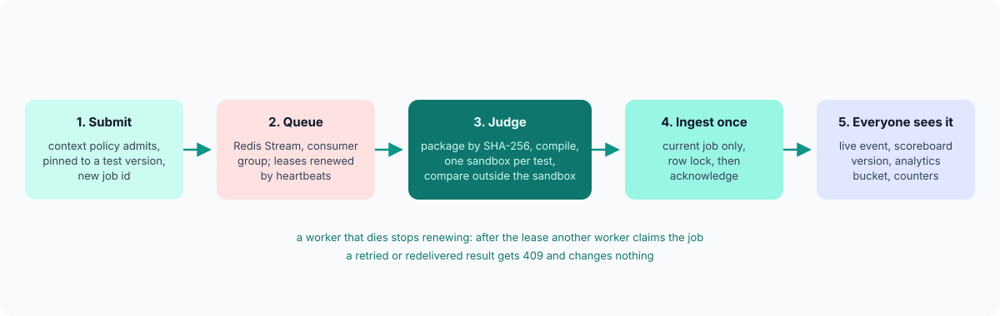

# Judging

How a submission becomes a verdict, and why the verdict is applied exactly once whatever
fails along the way. Code: `submissions/service.py` (dispatch and ingest),
`core/queue.py` (the stream), `judge/worker.py` (the worker loop), `judge/runner.py`
(compile, run, compare, score), `core/contract.py` (the messages both sides share).

## The contract

The API and the judge share only `core/contract.py`:

- `JudgeJob`: `job_id`, `attempt`, `submission_id`, language, source, the test package's
  SHA-256, limits (time, memory, output), the checker, the groups with their points, the
  test list (name, group, sample flag), optionally `only_tests` (run on the samples) or
  `custom_input` (run on the person's own input).
- `JudgeResult`: the verdict, score and maximum, peak time and memory, the compile output,
  per-test and per-group results, the output of a custom run, how long judging took, and
  an error message for internal errors.
- `Heartbeat`: `compiling` or `running`, and how many tests are done.

Test data is never in a job. The worker fetches the package by its hash, so a job is a
few kilobytes and the same package serves every submission to that problem version.

## The queue: a Redis Stream with leases

Jobs go on the stream `judge:jobs`, read through the consumer group `judges`
([ADR-0003](adr/0003-redis-streams-job-queue.md)).

1. **Taking a job.** A worker first tries `XAUTOCLAIM` for a job idle longer than the
   lease (a worker that died while judging it), then `XREADGROUP` for a new one. It takes
   one job at a time.
2. **The lease.** While judging, the worker re-claims its own message every `HEARTBEAT_S`
   (15 s by default), which resets the message's idle time. The lease is four heartbeats,
   at least 60 s. A worker that dies stops renewing; after the lease any other worker
   claims the job.
3. **Attempts.** The delivery count (`XPENDING`) is the attempt number. After three
   deliveries the worker reports an internal error ("the judge gave up after 3 attempts")
   instead of judging again, so a job that crashes every worker cannot loop forever.
4. **Acknowledging.** The worker posts the result first (retrying with backoff on network
   errors) and acknowledges and deletes the message only after the API accepted it. A
   crash between the two means the job is judged again; the API's idempotency makes that
   harmless.
5. **Shutting down.** `SIGTERM` lets the worker finish the job in hand before it exits, so
   a deploy never throws away a judgement.

Redis must not evict the stream: it runs with `maxmemory-policy noeviction` locally and on
ElastiCache.

## Ingesting a result exactly once

A submission row carries the `job_id` of the job responsible for it. `ingest` locks the row
(`SELECT ... FOR UPDATE`) and applies a result only when:

- the result's `job_id` is the submission's current `job_id`, and
- the submission is not already `done`.

Otherwise the API answers 409 and the worker treats that as success (someone else's
attempt already won). This makes every failure case safe:

| Case | What happens |
| --- | --- |
| The worker's POST times out after the API committed, and it retries | Second POST: 409, ignored |
| A worker dies after posting but before acknowledging; another judges the job again | Second result: 409, ignored |
| Staff rejudge while an old job is still running | The rejudge gives the submission a new `job_id`; the old job's late result is stale: 409 |
| Two workers somehow judge the same job at once | The row lock orders them; the first final result wins |

After applying a result the same transaction updates the problem's counters (a rejudge
never counts a solve twice) and calls every `on_judged` listener: the contest scoreboard
version, the analytics bucket. Then the API publishes `done` on the submission's Redis
channel for the browser.

## Live progress

The browser opens `GET /api/v1/submissions/{id}/events` (server-sent events). The API sends
the current state from the database first, so a late subscriber never misses the verdict,
then relays heartbeats (`compiling`, `running test 3`) and finally `done`. It releases its
database connection before streaming, so an open stream holds no connection. The web app
falls back to polling if the stream is cut.

## Judging one job

1. **Compile** in a sandbox with the box writable (20 s of CPU and 1 GB by default, 64
   processes for compiler drivers and linkers). A compiler bomb such as
   `#include "/dev/urandom"` becomes a compilation error: the file is not in the sandbox.
   Python and JavaScript are syntax-checked (`ast.parse`, `node --check`) so a syntax
   error is a compilation error, not a runtime error on the first test.
2. **Prepare the checker** if the problem has a custom one: compile it once per job in a
   sandbox of its own. A checker that does not compile is an internal error, never a
   wrong answer.
3. **Run the tests** group by group, in package order: samples first, then hidden groups.
   Each test is one sandbox run with only that test's input. After the first failure in a
   group with `stop_on_failure` (the default for hidden groups), the rest of the group is
   `SKIPPED`: points are all or nothing per group either way, so running them would only
   cost time.
4. **Classify** each run from its measurements, in a fixed order: internal error, output
   limit, time limit, memory limit, runtime error, then the checker. The order and why
   output comes before time are in [sandbox.md](sandbox.md#deciding-the-verdict).
5. **Score.** A group earns its points when every test in it is accepted; the score is the
   sum. The submission's verdict is AC when every test passed, otherwise the verdict of the
   first test that did not (an internal error anywhere wins, because then nothing else can
   be trusted). Time and memory are the maxima over the tests that ran.

### Checkers

| Kind | Accepts |
| --- | --- |
| `tokens` (default) | The same whitespace-separated tokens, optionally ignoring case. Line breaks and spacing do not matter, as with Kattis's default validator |
| `float` | Tokens equal, or numbers within an absolute or relative tolerance |
| `exact` | Line by line, ignoring trailing whitespace on each line and blank lines at the end |
| `custom` | The problem's checker program decides, with the Kattis convention (42 accepts, 43 rejects) or the testlib one (0 accepts, 1 and 2 reject); any other exit is an internal error |

Built-in checkers read both files in 64 KB chunks, so a 64 MB output is compared without
64 MB of tokens in memory. Their message ("token 3: expected 42, got 41") is returned for
samples only.

## Rejudging

Staff can rejudge chosen submissions or every submission to a problem.

- **On the original tests** (`POST /api/v1/submissions/rejudge`): the same version, a new
  job. Use it after a judge problem, for instance a worker that was misconfigured.
- **On the current tests** (`latest_version: true`, and `POST
  /api/v1/problems/{id}/rejudge`): each submission is moved to the problem's current
  version first. Use it after fixing a wrong test.

Either way the submission gets a new `job_id`, so whatever the old job still reports is
stale and ignored, and the listeners recompute (scoreboards, the analytics bucket, the
gradebook reads live data anyway).

## Problems and versions

A problem's tests live in immutable versions: a zip in the Kattis layout stored under
`packages/<sha256>.zip` ([problem-format.md](problem-format.md)). Editing tests, uploading
a package or changing the checker creates a new version and makes it current. Every
submission records the version it was judged against, so contest results and grades stay
reproducible after a test changes, and a rejudge is explicit about which tests it uses.

A problem can be published only when it has at least one hidden test and every reference
solution gets the verdict it is supposed to get on the current version (an `AC` solution
must be accepted, a solution marked `TLE` must time out). That rule catches the most common
way judges go wrong: a setter's own correct solution failing the tests.
