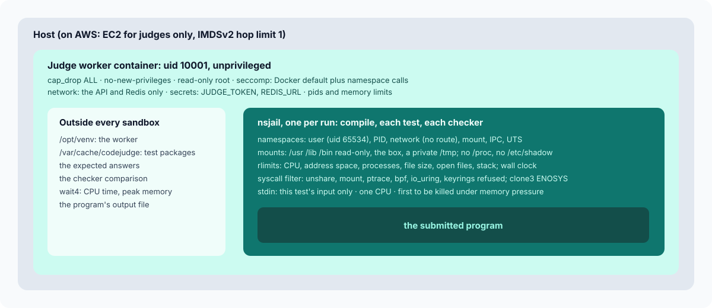

# The sandbox

A judge runs code that is hostile by assumption. A student may try to read the hidden
tests, a contestant may try to slow down everyone else, a candidate may try to reach the
network or the cloud's metadata service, and anyone may simply write an infinite loop or a
fork bomb by mistake. The sandbox has four jobs:

1. **Contain**: nothing a program does reaches the worker, other submissions, the network
   or the host.
2. **Limit**: CPU time, memory, processes, output, open files and wall clock are bounded
   per run.
3. **Measure**: CPU time and peak memory are measured exactly, so verdicts are decided
   from facts.
4. **Survive**: after any of the above, the next submission is judged correctly.

The code is `apps/api/src/codejudge/judge/sandbox.py` (one run) and `judge/runner.py`
(compile, tests, verdicts). The hostile suite in `apps/api/tests/judge/` runs inside the
real judge image with production hardening (`make test-judge`).

## Why not just Docker, and why not privileged

Judge0 is the best known open-source code runner. In 2024 three vulnerabilities were
published against it, two of them CVSS 10: CVE-2024-28185 (the sandbox followed a symlink
planted by the submission and wrote outside its directory), CVE-2024-28189 (a bypass of
that fix through `chown`) and CVE-2024-29021 (server-side requests from submissions
reaching its own database). Each was bad on its own; what turned them into a takeover of
the host is that Judge0's workers run as `--privileged` containers, so code that escaped
the inner sandbox was root in a container that can mount the host's disk.

Most judges run privileged for the same practical reason: their sandboxes (isolate,
nsjail with cgroups) want to create cgroups, and on cgroup v2 a container can only do that
when it is privileged or given a delegated cgroup subtree.

CodeJudge takes the other road: **the worker container has no privileges at all**, and the
sandbox inside it is built from user namespaces, which an unprivileged process may create.
An escape from the inner sandbox lands as an unprivileged user in an unprivileged
container with no route to anything but the API's internal endpoint and Redis. It is not
root anywhere. [ADR-0001](adr/0001-unprivileged-nsjail-sandbox.md)

## Layer 1: the worker container

| Control | Setting | Why |
| --- | --- | --- |
| Capabilities | `cap_drop: ALL` | No `CAP_SYS_ADMIN`, no `CAP_NET_RAW`, nothing to abuse |
| `no-new-privileges` | on | No setuid binary can raise privileges |
| Seccomp | Docker's default profile plus `clone, unshare, mount, umount2, pivot_root, sethostname, setdomainname, setns` (`infra/docker/judge-seccomp.json`) | Docker's default blocks namespace creation unless `CAP_SYS_ADMIN` is held. Allowing these few calls without the capability is what lets nsjail build a sandbox while the container stays unprivileged; the kernel still allows them only inside a new user namespace |
| Root filesystem | read-only | The worker cannot be modified, even by itself |
| Scratch | tmpfs `/tmp` (exec, 1 GB) and `/var/cache/codejudge` (2 GB), owned by uid 10001 | Compiled programs run from `/tmp`; test packages are cached in the other |
| User | uid 10001 | Never root |
| Limits | `pids_limit: 512`, `mem_limit: 3g`, `cpus: 2` | The outer bound on everything below |
| Network | Only the `judge` Compose network (internal: no internet), which holds the API and Redis | No database, no object storage, no web app, no metadata service |
| Secrets | `JUDGE_TOKEN` and `REDIS_URL` only | A compromised worker can post results and read jobs, nothing else ([ADR-0005](adr/0005-judges-hold-no-database-or-storage-credentials.md)) |

On AWS the same rules come from the `judge` Terraform module: ECS tasks on EC2 instances
of their own whose Docker daemon uses the judge profile as its default seccomp profile,
capabilities dropped, read-only root, IMDSv2 with a hop limit of 1 and
`ECS_AWSVPC_BLOCK_IMDS` so a task cannot borrow the instance role, a task role with no
policy, and a security group that allows egress only to the API and Redis. Fargate cannot
take a custom seccomp profile, which is why the judges are the one service on EC2.

## Layer 2: nsjail, one sandbox per run

Every compilation, every test and every custom checker gets a fresh nsjail (built from the
pinned 3.6 release in the image's first stage). Per run:

| Namespace or control | Effect |
| --- | --- |
| User namespace | The program runs as uid 65534 (nobody), mapped to the worker's uid 10001 outside. It has no capability that means anything outside the namespace |
| PID namespace | It sees only its own processes; `kill(-1, SIGKILL)` kills only them. When nsjail goes, the namespace goes |
| Network namespace | A loopback interface at most, no route: `connect()` fails with "Network is unreachable", DNS fails |
| Mount namespace | Read-only `/usr`, `/lib`, `/lib64` (where it exists), `/bin`, `/etc/alternatives`, the JDK's `/etc/java-21-openjdk`, `/etc/ld.so.cache`, `/dev/null`, `/dev/zero`, `/dev/urandom`; the box at `/box` (read-only while tests run, writable while compiling); a private tmpfs `/tmp` (64 MB for runs, 256 MB for compilers). Nothing else exists: no `/etc/shadow`, no `/opt` (where the worker lives), no `/var/cache/codejudge` (the test packages), no other submission |
| IPC and UTS | Private; hostname `judge` |
| Environment | `PATH=/usr/bin:/bin`, `LANG=C.UTF-8`, `HOME=/tmp`, `TMPDIR=/tmp`, plus a language's own `env` entries. Nothing from the worker (no `JUDGE_TOKEN`, no `REDIS_URL`) |
| `/proc` | Not mounted (see below) |
| CPU | `--max_cpus 1`, so multi-threaded programs cannot use more than one core's worth of other people's time |

### The syscall filter on the program

The outer seccomp profile has to allow namespace calls so nsjail can build the sandbox;
the program never needs them. A second filter (kafel, applied by nsjail just before
`exec`) makes them fail inside:

- `EPERM` for `unshare`, `setns`, `mount`, `umount`, `pivot_root`, `chroot`, `ptrace`,
  `process_vm_readv`, `process_vm_writev`, `bpf`, `keyctl`, `add_key`, `request_key`,
  `perf_event_open`, `userfaultfd`, the `io_uring` calls, module loading, `kexec_load`,
  `swapon`/`swapoff`, `reboot`, `acct`, `open_by_handle_at`, `name_to_handle_at`,
  `quotactl`, `syslog`, and setting the clock.
- `ENOSYS` for `clone3`, so the C library falls back to `clone` (which threads, and
  therefore the JVM and Node, still need) instead of failing.

### rlimits instead of cgroups

| rlimit | Value | Catches |
| --- | --- | --- |
| `RLIMIT_CPU` | the language's time limit, rounded up, plus 1 s | Infinite loops (`SIGKILL` when the hard limit is reached); the verdict uses the measured CPU time, not this backstop |
| `RLIMIT_AS` | memory limit plus the language's overhead, for `address` languages (Python, C++); unlimited for `rss` languages (Java, Node) | Memory bombs fail to allocate (`MemoryError`, `std::bad_alloc`) |
| `RLIMIT_NPROC` | the language's `threads` (1 for C++ and Python, 32 for Java, 16 for Node; 64 while compiling) | Fork and thread bombs stop at the limit |
| `RLIMIT_FSIZE` | the problem's output limit | Output floods: writes past it fail |
| `RLIMIT_NOFILE` | 64 | Descriptor exhaustion |
| `RLIMIT_STACK` | the memory limit, at most 256 MB | Deep recursion works up to the memory limit |
| `RLIMIT_CORE` | 0 | No core dumps |
| Wall clock (`--time_limit`) | CPU limit times `WALL_FACTOR` plus `WALL_EXTRA_S` | Programs that sleep or block on input forever |

cgroups would give a stricter memory ceiling, but they need a privileged or
cgroup-delegated container, which is exactly what this design avoids
([ADR-0002](adr/0002-rlimits-not-cgroups.md)). DMOJ's judge works the same way. The
weakness of rlimits (`RLIMIT_NPROC` counts per real uid, and every sandbox maps to uid
10001) is closed by running **one sandbox at a time per worker**: there is never a second
submission sharing the count. Throughput comes from more workers, not more sandboxes per
worker. The container's own `pids_limit` and `mem_limit` are the final bound.

For Java and Node, whose runtimes reserve gigabytes of address space they never touch, an
address-space limit would make every program fail at start. They get the runtime's own
heap flag (`-Xmx`, `--max-old-space-size`) set to the memory limit instead, the peak
resident memory is checked after the run, and the sandboxed process is the one the kernel
kills first if memory runs short: the worker raises the run's `oom_score_adj` to 1000
(allowed without privilege) before `exec`-ing nsjail.

### No /proc

Docker overmounts parts of a container's `/proc` (`/proc/kcore`, `/proc/keys` and others).
The kernel refuses to mount a fresh procfs inside a user namespace when the existing one
has such overmounts, so nsjail cannot give the sandbox a `/proc` without privileges. The
sandbox therefore has none, and nothing the judge runs needs it, with one consequence:
glibc finds the main program's `$ORIGIN` (used in `RPATH`) through `/proc/self/exe`, so
the JDK's launcher cannot find its own `libjli.so`. Java commands get
`LD_LIBRARY_PATH=/usr/lib/jvm/java-21/lib` from their language entry, and the image links
`/usr/lib/jvm/java-21` to the architecture's JDK so the path is the same on amd64 and
arm64. ([ADR-0008](adr/0008-no-proc-in-the-sandbox.md))

## Measuring

The worker starts `nsjail` through `/bin/sh -c 'echo 1000 > /proc/self/oom_score_adj;
exec "$@"'`, so the process it waits for is nsjail itself, and waits with `os.wait4`. The
`rusage` that `wait4` returns for nsjail includes every descendant nsjail reaped, which is
the whole sandbox:

- **CPU time** is `ru_utime + ru_stime`: the program's own CPU, summed over its threads
  and children, unaffected by sleeping or by other load on the machine (a program that
  sleeps for a second uses about 10 ms). nsjail's own start-up adds a few milliseconds.
- **Peak memory** is `ru_maxrss`, the largest resident set of any process in the sandbox.
- **Output** is the size of the file the program's stdout was redirected to (outside the
  sandbox).

Measured during development: 10 million loop iterations in Python took 0.36 s of CPU and
20 million took 0.75 s (linear); touching 100 MB read as 106 MB; a sandbox costs about
8 ms to start.

## Deciding the verdict

`Judge.classify` decides from the measurements, in this order:

1. **IE** (internal error) when nsjail could not start the program. This is the judge's
   failure, not the program's, so it never counts against anyone, and the job is retried.
2. **OLE** when the output reached the limit or the program got `SIGXFSZ`. This comes
   before the time limit on purpose: once a write is cut short at `RLIMIT_FSIZE`, C stdio
   marks the stream as failed and every later `fputs` returns at once *without a system
   call*, so the kernel never sends `SIGXFSZ` and a program printing in a loop spins until
   the CPU limit kills it. Output at the cap is the real evidence; judging it as a time
   limit would be wrong.
3. **TLE** when the CPU time passed the limit, the wall clock ran out, or the program got
   `SIGXCPU`.
4. **MLE** when the peak memory passed the limit (plus the runtime's overhead, for `rss`
   languages), when the program died with peak memory at 90% of the limit or more, or when
   its stderr says it ran out (`MemoryError`, `std::bad_alloc`, `OutOfMemoryError`, `heap
   out of memory`).
5. **RE** for any other non-zero exit or signal.
6. **AC** or **WA** from the checker, which runs outside the sandbox (built-in) or in a
   sandbox of its own (custom).

nsjail reports a child killed by a signal as exit status 128 plus the signal, and exits
with 255 when it cannot launch at all. Only 129 to 192 are read as signals, and a launch
failure is recognised first, so a sandbox that failed to start is never mistaken for a
program killed by "signal 127".

## Test data never enters the program's sandbox

The test package is unpacked on the worker under `/var/cache/codejudge`, which no sandbox
mounts. For each test the worker opens the input file and hands it to the program as
stdin; the expected answer stays where it is and is compared after the run. A custom
checker gets its own sandbox with read-only copies of exactly three files (input, answer,
output) and a writable feedback directory. Only sample tests return output and checker
messages to the user; for hidden tests those would reveal the answers.

Unpacking is itself defensive (`judge/packages.py`): the archive must match the SHA-256
named in the job; absolute paths, `..`, symlinks and devices are refused; entry count and
total size are capped; files are made read-only; and the directory appears only after a
complete unpack (temporary directory, then rename).

## What this does not protect against

- **Kernel vulnerabilities reachable through namespaces.** User namespaces widen the
  kernel's attack surface: a local privilege escalation bug in a namespace code path could
  let a program out of the sandbox. The syscall filter removes the most common entry
  points (`unshare`, `io_uring`, `bpf`, `userfaultfd`), and an escape still lands as an
  unprivileged user in an unprivileged container with no useful network, but it is not
  impossible. For a public judge that accepts code from anyone on the internet, add a
  kernel boundary: run the judge containers under gVisor (`runsc`) or Kata Containers, or
  on dedicated hosts that hold nothing else, and keep the kernel patched.
- **Side channels.** Timing and cache side channels between submissions on one core are
  not addressed; one sandbox per worker and `--max_cpus 1` reduce, not remove, them.
- **Resource fairness under extreme load.** CPU time is measured per program, so a busy
  machine does not turn an accepted solution into a time limit, but a machine swapping
  hard can stretch the wall clock past its allowance. Size workers so they do not swap.

Report sandbox escapes privately: [SECURITY.md](../../SECURITY.md).
